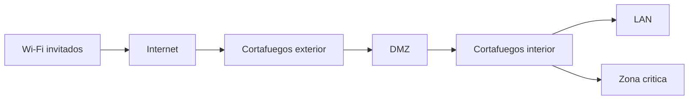

# Practica 1 - Perimetro y zonas

## 1. Tabla de ubicacion

| Servicio | Zona | Justificacion |
|---|---|---|
| Web corporativa publica | DMZ | Debe ser accesible desde Internet y estar separada de la LAN. |
| Servidor de correo | DMZ | Necesita comunicarse con Internet para enviar y recibir correo. |
| Pasarela VPN | DMZ | Recibe conexiones desde Internet para dar acceso remoto seguro. |
| Proxy saliente e inverso | DMZ | Intermedia entre Internet y la red interna. |
| HMI de planta y carpeta de planos | Zona critica | Son recursos importantes y solo deben acceder usuarios autorizados. |
| Autoridad de certificacion srv-ca | Zona critica | Guarda claves importantes y debe tener muy pocos accesos. |
| Servidor de copias de seguridad | Zona critica | Guarda informacion importante y debe estar protegido. |
| Portatiles de ingenieros y operarios | LAN | Son equipos internos de los trabajadores. |
| Wi-Fi de invitados | Zona de invitados | Son dispositivos no controlados y solo necesitan acceso a Internet. |
| Servidor de registros y monitorizacion | Zona critica | Guarda informacion de seguridad y debe estar protegido. |

### Zona de invitados

Se crea una zona propia para la Wi-Fi de invitados porque sus dispositivos no son de confianza.

Solo tendran acceso a Internet y no podran acceder a la LAN ni a la zona critica.

---

## 2. Tabla de flujos

| Origen -> destino | Permitido | Ejemplo |
|---|---|---|
| Internet -> DMZ | Si, solo servicios publicados | HTTPS hacia la web o conexion a la VPN. |
| Internet -> LAN | No | Nadie desde Internet entra directamente a los equipos internos. |
| Internet -> Zona critica | No | No se puede acceder directamente al HMI, CA o copias. |
| DMZ -> LAN | No, salvo casos necesarios | Normalmente los servidores de la DMZ no pueden entrar en la LAN. |
| DMZ -> Zona critica | Solo lo necesario | La VPN puede permitir acceso autorizado al HMI. |
| LAN -> DMZ | Si | Un administrador puede gestionar un servidor de la DMZ. |
| LAN -> Internet | Si | Los trabajadores pueden navegar por Internet. |
| LAN -> Zona critica | Si, pero restringido | Los ingenieros pueden acceder al HMI o planos. |
| Invitados -> Internet | Si | Los invitados pueden navegar. |
| Invitados -> LAN | No | No pueden acceder a los equipos de la empresa. |
| Invitados -> Zona critica | No | No pueden acceder al HMI, CA o copias. |

---

## 3. Diagrama de red

En la DMZ estan la web, correo, VPN y proxy.

En la LAN estan los portatiles de ingenieros y operarios.

En la zona critica estan el HMI, planos, CA, copias de seguridad y servidor de registros.

---

## 4. Reflexion

Si el atacante consigue controlar el servidor web, solo tendra acceso a ese servidor dentro de la DMZ.

No podra acceder directamente a la LAN ni a la zona critica porque el cortafuegos interior y la segmentacion bloquean esas conexiones.

Para seguir avanzando necesitara encontrar otro fallo de seguridad.
